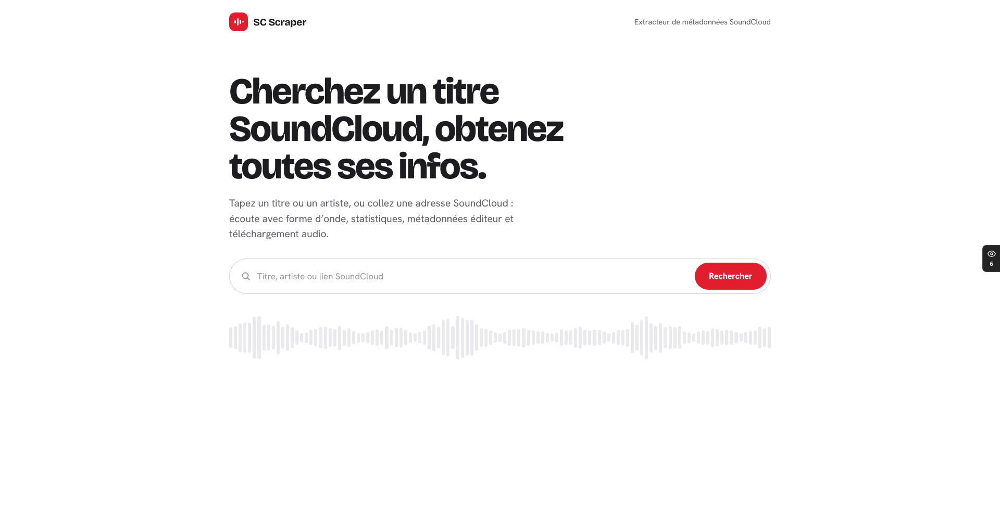
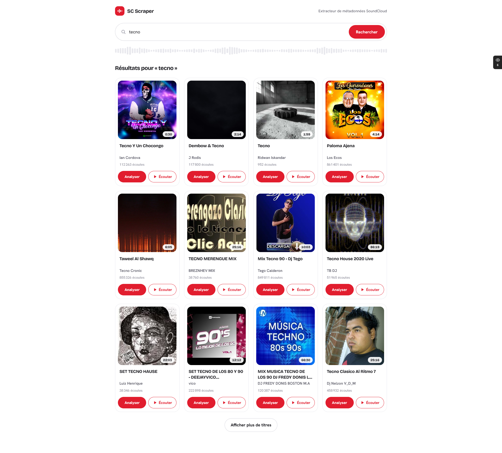
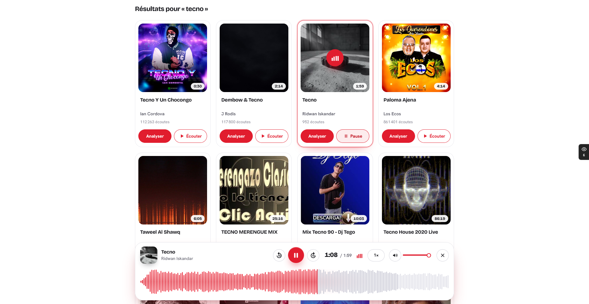
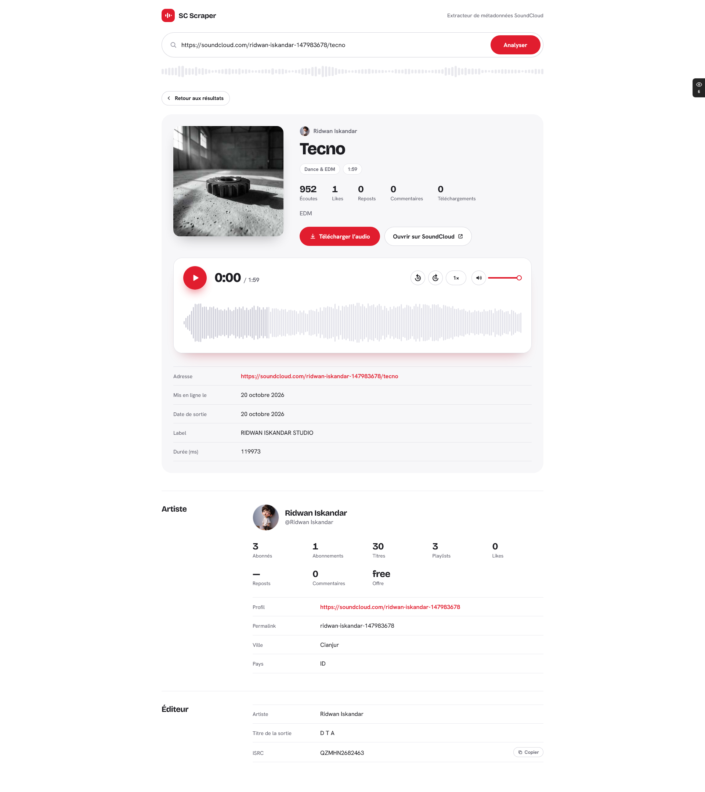

# SC Scraper (SoundCloud Downloader & Metadata Extractor)

**Mots-clés / Keywords :** SoundCloud downloader, SoundCloud scraper, SoundCloud to MP3, PHP SoundCloud downloader, download SoundCloud audio, extracteur SoundCloud, convertisseur SoundCloud, téléchargeur SoundCloud, SoundCloud metadata API, HLS downloader, SoundCloud search, waveform player, SoundCloud grabber, mp3 downloader, open source SoundCloud scraper.

Outil d'extraction de métadonnées SoundCloud, de recherche, d'écoute directe avec forme d'onde et de téléchargement audio. Il se déploie sur n'importe quel serveur PHP, sans Composer ni npm. FFmpeg n'est requis que pour le mode de téléchargement côté serveur, facultatif.

---

## Table des matières

1. [Présentation générale](#1-présentation-générale)
2. [Captures d'écran](#2-captures-décran)
3. [Fonctionnalités](#3-fonctionnalités)
4. [Prérequis](#4-prérequis)
5. [Installation](#5-installation)
6. [Structure du projet](#6-structure-du-projet)
7. [Utilisation](#7-utilisation)
8. [Référence des points d'entrée PHP](#8-référence-des-points-dentrée-php)
9. [Architecture technique](#9-architecture-technique)
10. [Lecteur audio](#10-lecteur-audio)
11. [Flux de téléchargement audio](#11-flux-de-téléchargement-audio)
12. [Paramètres et configuration](#12-paramètres-et-configuration)
13. [Conventions de code et de design](#13-conventions-de-code-et-de-design)
14. [Dépannage](#14-dépannage)
15. [Limitations connues et sécurité](#15-limitations-connues-et-sécurité)
16. [Licence](#16-licence)

---

## 1. Présentation générale

SC Scraper est un outil léger composé de trois fichiers PHP : une page unique qui contient toute l'interface (HTML, CSS et JavaScript), un backend de scraping et de recherche, et un point d'entrée de téléchargement côté serveur.

À partir d'un titre, d'un nom d'artiste ou d'une URL publique SoundCloud, l'application permet de :

- rechercher des titres avec suggestions pendant la frappe ;
- écouter un résultat directement, sans quitter la liste, grâce à un lecteur à forme d'onde fixé en bas de page ;
- analyser un titre ou un profil pour en extraire les métadonnées structurées (artiste, titre, statistiques, informations d'éditeur, flux audio disponibles) ;
- télécharger le fichier audio directement depuis le navigateur.

Le serveur PHP effectue les requêtes réseau qui exigent d'éviter les restrictions CORS (scraping de la page, recherche, résolution des flux). Le navigateur se charge de l'écoute, de l'assemblage des segments audio et de la génération du fichier téléchargeable.



---

## 2. Captures d'écran

**Recherche et résultats.** Chaque résultat est une carte avec deux actions : Analyser et Écouter.



**Lecture directe.** Le lecteur à forme d'onde est fixé en bas de la page. La carte en cours de lecture est surlignée et son bouton devient Pause.



**Fiche détaillée d'un titre.** Statistiques, lecteur, téléchargement, artiste et métadonnées d'éditeur.



---

## 3. Fonctionnalités

### Recherche

- Champ unique qui accepte un titre, un artiste ou une adresse SoundCloud. Le bouton d'action s'adapte : il affiche Rechercher pour un texte libre et Analyser pour une URL.
- Suggestions pendant la frappe (à partir de 2 caractères), navigables au clavier : flèches haut et bas, Entrée pour valider, Échap pour fermer.
- Résultats présentés en cartes : pochette, durée, titre, artiste, nombre d'écoutes.
- Pagination par le bouton Afficher plus de titres (12 titres par page).

### Écoute directe depuis les cartes

- Bouton Écouter sur chaque carte. Un clic sur la pochette a le même effet.
- Lecteur à forme d'onde fixé en bas de page : lecture et pause, saut de 10 secondes, vitesse, volume, déplacement par clic ou glisser sur l'onde.
- Les cartes reflètent l'état de lecture : liseré rouge sur le titre en cours, égaliseur animé sur la pochette, libellé du bouton Écouter, Pause ou Reprendre.
- Un seul son est joué à la fois : l'ouverture de la fiche détaillée d'un titre ferme le lecteur du bas.

### Extraction de métadonnées

L'outil récupère les données publiques de la page analysée :

- Artiste : nom, identifiant, nombre d'abonnés, abonnements, titres publiés, playlists, likes, reposts, commentaires, statut de vérification, badges d'abonnement, avatar, ville et pays.
- Titre : nom, genre, description, durée, date de mise en ligne et de sortie, label, statistiques d'écoute, de likes, de reposts, de commentaires et de téléchargements, URL de la pochette et de la forme d'onde.
- Éditeur, lorsqu'il est renseigné : artiste, album, titre de la sortie, code ISRC, code UPC ou EAN, lignes de copyright P et C. Les codes ISRC et UPC peuvent être copiés en un clic.
- Flux audio disponibles, avec preset, format, protocole et qualité.

### Téléchargement audio

L'application vérifie la disponibilité effective des flux via un proxy PHP, puis propose un bouton de téléchargement par qualité. Le téléchargement se déroule dans le navigateur : les segments HLS sont récupérés un à un, assemblés en mémoire, puis proposés sous forme de fichier. Un mode alternatif via FFmpeg (`telechargement.php`) existe pour l'assemblage côté serveur.

---

## 4. Prérequis

**Côté serveur**

- PHP 7.4 minimum (PHP 8.x recommandé).
- `allow_url_fopen = On` dans `php.ini`. Toutes les requêtes sortantes de `sc.php` utilisent `file_get_contents` avec un contexte HTTP, et non cURL.
- L'extension `openssl`, pour les requêtes HTTPS.
- Un serveur web Apache, Nginx ou équivalent avec support PHP. Pour un essai local, le serveur intégré de PHP suffit.
- FFmpeg accessible dans le `PATH`, uniquement si vous utilisez `telechargement.php`.

**Côté client**

- Un navigateur moderne : Chrome 80+, Edge 80+, Firefox 74+ ou Safari 13.1+. Le code utilise `fetch`, `Blob`, `ResizeObserver`, `canvas` et l'opérateur `?.`.
- Aucune installation de dépendance. Deux ressources externes sont chargées par le navigateur :
  - les polices Bricolage Grotesque et Hanken Grotesk via Google Fonts (à défaut, des polices système prennent le relais) ;
  - la bibliothèque hls.js depuis jsDelivr, chargée uniquement à la première lecture et uniquement si le navigateur ne lit pas le HLS nativement (c'est le cas de Safari, qui n'en a pas besoin).

**Permissions système**

- Le processus PHP doit pouvoir créer le dossier `MP3/` à la racine du projet (voir la section 12).
- Le répertoire temporaire système (`sys_get_temp_dir()`) doit être accessible en écriture : il sert à `telechargement.php` et au cache du client_id de `sc.php`.

---

## 5. Installation

### Étape 1 : cloner le dépôt

```bash
git clone https://github.com/dibikre/sc-scraper.git
cd sc-scraper
```

### Étape 2 : lancer l'application

En local, pour essayer rapidement :

```bash
php -S localhost:4000
```

Ouvrez ensuite `http://localhost:4000/index.php`.

Sur un serveur, copiez les trois fichiers à la racine de votre répertoire web (par exemple `/var/www/html/sc-scraper/` sous Apache, ou le dossier `public/` de votre hébergeur) :

```
index.php
sc.php
telechargement.php
```

Le dossier `Captures/` ne sert qu'à illustrer ce README et n'est pas nécessaire au fonctionnement. Il n'y a aucune dépendance à installer via Composer ou npm : le projet est volontairement sans gestionnaire de dépendances.

### Étape 3 : vérifier les permissions

```bash
# Le dossier MP3/ est créé automatiquement : PHP doit pouvoir écrire dans le dossier du projet
chmod 755 /var/www/html/sc-scraper/
```

### Étape 4 : vérifier FFmpeg (facultatif)

```bash
ffmpeg -version
```

FFmpeg n'est nécessaire que pour `telechargement.php`. L'écoute, la recherche, l'analyse et le téléchargement depuis l'interface (`index.php`) fonctionnent sans lui.

### Étape 5 : tester l'installation

Ouvrez `index.php` dans votre navigateur. Si la page affiche le titre d'accueil et la barre de recherche, l'installation est réussie. Tapez un mot dans la barre : des suggestions doivent apparaître, ce qui confirme que le serveur atteint bien SoundCloud.

---

## 6. Structure du projet

```
sc-scraper/
|
|-- index.php              Page principale : interface, recherche, lecteur
|                          et téléchargement côté client
|
|-- sc.php                 Backend PHP : scraping, recherche, suggestions,
|                          proxy de résolution des flux audio
|
|-- telechargement.php     Endpoint de téléchargement côté serveur :
|                          assemblage des segments HLS via FFmpeg
|
|-- Captures/              Images utilisées par ce README
|
`-- MP3/                   Créé automatiquement : copies JSON des analyses
```

### Rôle de chaque fichier

**`index.php`**

Point d'entrée de l'application. Il contient toute l'interface : HTML, CSS dans une balise `<style>` et JavaScript dans une balise `<script>`. Il ne fait aucun traitement PHP, il sert une page statique et appelle `sc.php`. Ses principaux blocs JavaScript sont :

- la recherche et les suggestions ;
- le rendu des cartes de résultats (`htmlCartePiste`) et la synchronisation de leur état (`synchroniserCartes`) ;
- la classe `LecteurOnde`, qui gère l'audio, la forme d'onde dessinée sur un canvas et les commandes ;
- le lecteur ancré en bas de page (`ouvrirDock`, `fermerDock`, `ecouterPiste`) ;
- le rendu de la fiche détaillée (titre, artiste, éditeur) ;
- le téléchargement côté client (`demarrerTelechargement`).

**`sc.php`**

Backend de l'application. Il répond toujours en JSON et expose plusieurs actions, décrites à la section 8 : scraping d'une page, vérification et résolution des flux, suggestions de recherche, recherche de titres.

**`telechargement.php`**

Reçoit une URL de playlist M3U8, un nom de fichier et un jeton optionnel. Il lance FFmpeg en sous-processus pour assembler les segments HLS en un fichier audio, puis envoie ce fichier au navigateur avec l'en-tête `Content-Disposition: attachment`. L'interface actuelle ne l'appelle pas : il s'utilise directement par URL ou depuis un autre outil.

---

## 7. Utilisation

### Rechercher un titre

1. Ouvrez l'application.
2. Tapez un titre ou un nom d'artiste dans la barre de recherche. Des suggestions apparaissent après deux caractères.
3. Validez avec Entrée, avec le bouton **Rechercher** ou en choisissant une suggestion.
4. Les résultats s'affichent sous forme de cartes. Le bouton **Afficher plus de titres** charge la suite.

### Écouter un résultat

1. Sur une carte, cliquez sur **Écouter** (ou sur la pochette).
2. Le bouton affiche un indicateur de chargement le temps de récupérer le flux, puis le lecteur apparaît en bas de la page et la lecture démarre.
3. Cliquez sur **Pause** sur la carte, ou sur le bouton central du lecteur, pour interrompre la lecture. Le bouton devient **Reprendre**.
4. Cliquez sur une autre carte pour changer de titre. La dernière demande l'emporte si vous enchaînez les clics.
5. La croix du lecteur le ferme.

Si un titre n'est proposé qu'en flux chiffré, une notification l'indique : utilisez alors Analyser puis le téléchargement.

### Analyser un titre

1. Cliquez sur **Analyser** sur une carte, ou collez l'URL complète d'un titre dans la barre de recherche, par exemple `https://soundcloud.com/nom-artiste/nom-titre`. Le bouton de la barre affiche alors **Analyser**.
2. Une barre d'ondes animée indique la progression de la récupération.
3. La fiche détaillée s'affiche : titre, statistiques, lecteur, boutons d'action, puis sections Artiste et Éditeur.
4. Si vous venez d'une recherche, le bouton **Retour aux résultats** ramène à la liste.

### Télécharger un titre

1. Sur la fiche détaillée, cliquez sur **Télécharger l'audio** pour afficher les qualités disponibles.
2. L'application vérifie quels flux sont effectivement accessibles (quelques secondes).
3. Pour chaque flux valide, la ligne indique le format (MP3, AAC ou Opus), le débit, le profil (`mp3_0_1`, `aac_1_0`, `opus_0_1`, etc.), le protocole et la mention Chiffré ou Ouvert.
4. Cliquez sur **Télécharger** sur la qualité souhaitée. Une barre de progression par segment s'affiche.
5. À la fin de l'assemblage, le fichier est proposé automatiquement au téléchargement.

### Analyser un profil artiste

Collez l'URL d'un profil (par exemple `https://soundcloud.com/nom-artiste`). Seule la section **Artiste** est affichée, sans fiche de titre ni lecteur.

### Raccourcis clavier du lecteur

Ils s'appliquent lorsque la forme d'onde a le focus.

| Touche | Action |
|--------|--------|
| Espace ou K | Lecture ou pause |
| Flèche droite ou haut | Avancer de 5 secondes |
| Flèche gauche ou bas | Reculer de 5 secondes |
| Maj + flèche | Saut de 15 secondes |
| Page haut / Page bas | Avancer ou reculer de 10 % de la durée |
| Début / Fin | Aller au début ou à la fin |
| M | Couper ou rétablir le son |

Le bouton de vitesse fait défiler 1x, 1,25x, 1,5x, 2x puis 0,75x. Les touches multimédia du clavier et de l'écran verrouillé sont prises en charge via l'API Media Session.

---

## 8. Référence des points d'entrée PHP

### `sc.php`

Toutes les réponses sont au format JSON. Les erreurs renvoient `{ "success": false, "error": "..." }` avec un code HTTP adapté.

| Appel | Rôle |
|-------|------|
| `sc.php?url=<url>` | Scrape une page SoundCloud (titre ou profil) |
| `sc.php?action=suggestions&q=<texte>` | Suggestions de recherche |
| `sc.php?action=rechercher&q=<texte>` | Recherche de titres |
| `sc.php?action=check_streams` | Vérifie la disponibilité de plusieurs flux |
| `sc.php?action=resolve_stream` | Résout l'URL d'un flux unique |

**Scraping : `?url=`**

Paramètre : `url`, adresse d'un titre ou d'un profil SoundCloud. Seuls le schéma, l'hôte et le chemin sont conservés (la chaîne de requête et le fragment sont retirés).

Réponse :

```json
{
  "success": true,
  "url": "https://soundcloud.com/artiste/titre",
  "data": {
    "api_client": { "id": "..." },
    "artist": { "username": "...", "followers_count": 0, "...": "..." },
    "track": {
      "id": 0,
      "title": "...",
      "duration_ms": 0,
      "waveform_url": "...",
      "track_authorization": "...",
      "publisher": { "isrc": "...", "...": "..." },
      "audio_streams": [
        { "url": "...", "preset": "mp3_0_1", "protocol": "hls", "mime": "audio/mpeg", "quality": "sq" }
      ]
    }
  }
}
```

Les blocs `artist`, `track` et `publisher` ne sont présents que si la page les contient. Chaque analyse réussie est aussi enregistrée dans le dossier `MP3/` (voir la section 12).

**Suggestions : `?action=suggestions`**

| Paramètre | Obligatoire | Description |
|-----------|-------------|-------------|
| `q` | Oui | Texte saisi, 2 caractères minimum, 100 maximum |
| `limit` | Non | Nombre de suggestions, de 1 à 10 (8 par défaut) |

Réponse : `{ "success": true, "suggestions": ["amapiano mix", "..."] }`. La réponse est mise en cache côté navigateur pendant 5 minutes (`Cache-Control: private, max-age=300`).

**Recherche : `?action=rechercher`**

| Paramètre | Obligatoire | Description |
|-----------|-------------|-------------|
| `q` | Oui | Texte recherché, 2 caractères minimum, 100 maximum |
| `limit` | Non | Nombre de titres, de 1 à 24 (12 par défaut) |
| `offset` | Non | Décalage de pagination, de 0 à 200 |

Réponse :

```json
{
  "success": true,
  "requete": "amapiano",
  "pistes": [
    {
      "id": 0,
      "titre": "...",
      "artiste": "...",
      "url": "https://soundcloud.com/...",
      "pochette": "https://...-large.jpg",
      "duree": "3:42",
      "ecoutes": 128430,
      "genre": "..."
    }
  ],
  "suivant": true
}
```

Le champ `suivant` indique qu'une page supplémentaire existe.

**Vérification des flux : `?action=check_streams`**

| Paramètre | Obligatoire | Description |
|-----------|-------------|-------------|
| `streams` | Oui | Tableau JSON `[{ "index": 0, "url": "..." }]` |
| `client_id` | Oui | Identifiant client renvoyé par le scraping (`api_client.id`) |
| `track_authorization` | Non | Jeton du titre (`track.track_authorization`) |

Réponse : `{ "success": true, "valid": [{ "index": 0, "url": "https://....m3u8", "licenseAuthToken": null }] }`. Les flux introuvables (404) ou invalides sont simplement omis de la liste.

**Résolution d'un flux : `?action=resolve_stream`**

Paramètres : `stream_url`, `client_id` (obligatoires) et `track_authorization` (facultatif). Réponse : `{ "success": true, "url": "...", "licenseAuthToken": null }`. Cette action est utilisable indépendamment de l'interface.

### `telechargement.php`

| Paramètre | Obligatoire | Description |
|-----------|-------------|-------------|
| `playlist` | Oui | URL complète de la playlist M3U8 signée |
| `filename` | Non | Nom du fichier de sortie, sans extension |
| `token` | Non | Jeton de licence (accepté mais non utilisé par la commande) |

Le format de sortie est déduit du nom de fichier : s'il contient `opus`, le fichier est encodé en Opus (160 kbit/s) ; s'il contient `aac`, le flux est copié sans réencodage dans un conteneur `m4a` ; dans tous les autres cas, il est converti en MP3 192 kbit/s. En cas d'échec, la réponse est un JSON avec le code de retour de FFmpeg et les dernières lignes de son journal.

---

## 9. Architecture technique

### Cycle de vie d'une recherche

```
Navigateur                          sc.php                       SoundCloud
    |                                  |                              |
    |-- ?action=suggestions&q=... ---->|                              |
    |                                  |-- api-v2 /search/queries --->|
    |<-- { suggestions: [...] } -------|<-----------------------------|
    |                                  |                              |
    |-- ?action=rechercher&q=... ----->|                              |
    |                                  |-- api-v2 /search/tracks ---->|
    |<-- { pistes: [...], suivant } ---|<-----------------------------|
    |                                  |                              |
    | Rendu des cartes                 |                              |
```

Les appels à l'API de recherche utilisent le `client_id` public que SoundCloud publie dans sa page d'accueil (bloc `window.__sc_hydration`). Il est conservé une heure dans un fichier temporaire (`sc_scraper_client_id.txt` dans le répertoire temporaire système). S'il est refusé (HTTP 401 ou 403), il est relu une fois, sans autre contournement.

### Cycle de vie d'une écoute directe

```
Navigateur                          sc.php                       SoundCloud
    |                                  |                              |
    | [Clic sur Écouter]               |                              |
    |-- ?url=<url du titre> ---------->|-- GET page du titre -------->|
    |<-- { track, artist, api_client } |<-----------------------------|
    |                                  |                              |
    |-- ?action=check_streams -------->|-- GET stream_url ----------->|
    |   (meilleur flux non chiffré)    |<-- { url } ------------------|
    |<-- { valid: [{ url }] } ---------|                              |
    |                                  |                              |
    |-- lecture directe du flux (MP3 progressif ou HLS) ------------->|
    |<-- données audio ----------------------------------------------|
```

### Cycle de vie d'une analyse

```
Navigateur                          sc.php                       SoundCloud
    |                                  |                              |
    |-- GET sc.php?url=<url_sc> ------>|                              |
    |                                  |-- GET <url_sc> ------------->|
    |                                  |<-- HTML de la page ----------|
    |                                  |                              |
    |                                  | Extraction de la variable
    |                                  | window.__sc_hydration,
    |                                  | analyse JSON, structuration,
    |                                  | copie dans MP3/
    |                                  |                              |
    |<-- JSON { success, data } -------|                              |
    |                                  |                              |
    | Rendu de la fiche                |                              |
```

### Cycle de vie d'un téléchargement

```
Navigateur                          sc.php                       SoundCloud
    |                                  |                              |
    | [Clic sur "Télécharger l'audio"] |                              |
    |-- ?action=check_streams -------->|-- GET stream_url ----------->|
    |   &streams=[{index,url}...]      |<-- { url: "https://..." } ---|
    |   &client_id=...                 |                              |
    |   &track_authorization=...       |                              |
    |<-- { valid: [{index, url}] } ----|                              |
    |                                  |                              |
    | [Pour chaque segment HLS]        |                              |
    |-- GET segment.m4s ------------------------------------------>   |
    |<-- données binaires ---------------------------------------     |
    |                                  |                              |
    | Assemblage en mémoire (Blob)     |                              |
    | Déclenchement du téléchargement  |                              |
```

### Pourquoi le navigateur récupère-t-il lui-même les segments ?

Les segments audio (`*.m4s`, `*.ts`) sont servis par les CDN de SoundCloud sans restriction particulière. Les récupérer directement depuis le navigateur évite de faire transiter de grandes quantités de données binaires par le serveur PHP. Seules les requêtes soumises à des restrictions CORS passent par `sc.php`.

---

## 10. Lecteur audio

Le même composant, la classe `LecteurOnde`, anime deux lecteurs : celui de la fiche détaillée et celui fixé en bas de page lors d'une écoute depuis les cartes.

### Choix du flux

Seuls les flux non chiffrés sont lus. L'ordre de préférence est :

1. MP3 en téléchargement progressif ;
2. MP3 en HLS ;
3. AAC (MP4) en HLS.

Pour chaque candidat, l'URL est résolue par `check_streams`. Si un flux échoue, le suivant est essayé. Le HLS est lu nativement lorsque le navigateur le permet, sinon par hls.js.

### Forme d'onde

La forme d'onde est dessinée sur un canvas : barres arrondies, partie lue en dégradé rouge, partie mise en mémoire tampon en gris moyen, reste en gris clair. Elle montre une tête de lecture, un aperçu de position et une infobulle de temps au survol, et réagit au toucher sur mobile. Si SoundCloud ne fournit pas la vraie forme d'onde, une onde de substitution, stable pour un même titre, est affichée (voir la section 15).

### Comportements notables

- Si le flux ne contient qu'un extrait du titre (durée du flux inférieure à 97 % de celle du titre), un message le signale.
- Le volume choisi est mémorisé dans le navigateur (`localStorage`, clé `sc_scraper_volume`).
- Les barres s'animent à l'apparition. Les animations sont désactivées lorsque le système demande de réduire les mouvements (`prefers-reduced-motion`).
- La zone d'onde est un `slider` accessible : valeurs minimale, maximale et courante annoncées, focus visible, commandes clavier.
- Sur écran étroit, les boutons de saut de 10 secondes et le volume sont masqués du lecteur ancré ; l'onde reste utilisable au toucher.

---

## 11. Flux de téléchargement audio

### Format des flux SoundCloud

SoundCloud distribue l'audio en HLS (HTTP Live Streaming) et, pour certains titres, en MP3 progressif. Un flux HLS est décrit par une playlist M3U8 qui référence une suite de segments binaires. Les profils généralement rencontrés sont :

| Identifiant preset | Format audio | Protocole | Qualité |
|--------------------|--------------|-----------|---------|
| `mp3_0_1`          | MP3          | HLS       | Standard |
| `aac_1_0`          | AAC / M4A    | HLS       | Standard |
| `opus_0_1`         | Opus         | HLS       | Standard |
| `mp3_1_0`          | MP3          | HLS       | Haute qualité |

Certains flux sont chiffrés. L'interface affiche alors la mention **Chiffré**. Ils sont exclus de l'écoute directe et leur assemblage dans le navigateur n'est pas pris en charge (voir la section 15).

### Assemblage côté client

1. Récupération de la playlist M3U8 depuis l'URL résolue.
2. Extraction de l'URL du segment d'initialisation (`#EXT-X-MAP:URI=`), qui contient les métadonnées du conteneur.
3. Téléchargement séquentiel de chaque segment audio, avec progression affichée.
4. Concaténation de tous les `ArrayBuffer` en un seul `Blob` du type MIME approprié.
5. Création d'une URL d'objet temporaire (`URL.createObjectURL`) et déclenchement du téléchargement par un élément `<a>` cliqué par programme.

Le nom du fichier est composé du titre (caractères spéciaux remplacés par des underscores) et du profil. L'extension est `.opus` si le profil contient `opus`, `.m4a` dans tous les autres cas, y compris pour les profils MP3.

### Assemblage côté serveur via FFmpeg

`telechargement.php` délègue l'assemblage à FFmpeg, qui télécharge lui-même les segments à partir de l'URL M3U8, les assemble et encode le résultat. La commande utilise notamment `-allowed_extensions ALL` et une liste blanche de protocoles (`file`, `http`, `https`, `tcp`, `tls`, `crypto`, `data`), afin que FFmpeg accepte les clés intégrées sous forme d'URI `data:` dans la playlist. Le fichier est généré dans le répertoire temporaire, envoyé par blocs de 8 Ko, puis supprimé.

---

## 12. Paramètres et configuration

### Limites d'exécution PHP

`telechargement.php` ajuste les limites pour les fichiers longs :

```php
set_time_limit(300);        // 5 minutes maximum d'exécution
ini_set('memory_limit', '256M');
```

Si votre serveur impose des limites plus strictes dans `php.ini` ou dans la configuration du serveur web, ajustez-les manuellement.

### Sauvegarde automatique des analyses

À chaque scraping réussi, `sc.php` écrit silencieusement les données extraites dans un fichier JSON horodaté du dossier `MP3/`, créé à la racine du projet. Le nom reprend l'hôte et le chemin de l'URL, suivis de la date et de l'heure. Ces fichiers sont destinés au débogage ou à l'archivage personnel.

Ils contiennent notamment l'identifiant client et le jeton d'autorisation du titre. Il est donc recommandé d'interdire l'accès web à ce dossier. Exemple pour Apache, dans un fichier `MP3/.htaccess` :

```
Require all denied
```

Pour désactiver complètement la sauvegarde, supprimez ou commentez le bloc « Sauvegarde silencieuse » de `sc.php` (de `$nomFichier = ...` jusqu'à l'appel à `file_put_contents`).

### Délais d'attente des requêtes HTTP

Configurés dans `sc.php` :

| Requête | Délai |
|---------|-------|
| Scraping de la page SoundCloud | 30 secondes |
| Vérification d'un flux (par flux) | 8 secondes |
| Résolution d'un flux unique | 15 secondes |
| Suggestions et recherche | 8 secondes |
| Lecture du `client_id` (page d'accueil) | 15 secondes |

Ces valeurs se modifient directement dans les contextes de flux (`stream_context_create`) de chaque fonction.

### Paramètres de l'interface

Les constantes du lecteur se trouvent en tête du bloc « Lecteur à forme d'onde » dans `index.php` :

| Constante | Rôle | Valeur par défaut |
|-----------|------|-------------------|
| `VITESSES_LECTURE` | Vitesses proposées, dans l'ordre de défilement | 1, 1.25, 1.5, 2, 0.75 |
| `SAUT_SECONDES` | Saut des boutons reculer et avancer | 10 |
| `PAS_CLAVIER` | Pas des flèches sur la forme d'onde | 5 |
| `TAILLE_PAGE` | Nombre de titres chargés par page de recherche | 12 |

---

## 13. Conventions de code et de design

**Nommage.** Les noms de variables, de fonctions et de classes sont en français, côté PHP comme côté JavaScript (`rechercherPistes`, `verifierFlux`, `htmlCartePiste`, `LecteurOnde`, `synchroniserCartes`, etc.). Les clés des réponses JSON de recherche sont en français (`titre`, `artiste`, `pochette`, `duree`, `ecoutes`, `suivant`). Les clés issues des métadonnées SoundCloud (`track`, `artist`, `audio_streams`, etc.) gardent leur nom d'origine.

**Design.** Fond blanc, boutons principaux rouges (`#e11d2e`), boutons secondaires en contour. Polices Bricolage Grotesque pour les titres et Hanken Grotesk pour le texte. Les couleurs, rayons et polices sont des variables CSS déclarées dans `:root` au début de `index.php`.

**Accessibilité.** Focus visible sur tous les contrôles, libellés accessibles sur les boutons d'action des cartes (qui incluent le titre), états annoncés (`aria-pressed`, `aria-busy`, `role="status"`), liste de suggestions conforme au motif combobox, respect de `prefers-reduced-motion`.

**Un seul fichier d'interface.** Pour faciliter le déploiement, HTML, CSS et JavaScript restent dans `index.php`. Aucune étape de compilation n'est nécessaire.

---

## 14. Dépannage

### La page s'affiche mais aucune recherche ni analyse ne donne de résultat

Vérifiez que `sc.php` est accessible. Ouvrez directement dans le navigateur :

```
https://votre-domaine.com/sc-scraper/sc.php?url=https://soundcloud.com/artiste/titre
```

La réponse doit être un objet JSON avec `"success": true`. Si une erreur 500 s'affiche, activez temporairement l'affichage des erreurs PHP en ajoutant au début de `sc.php` :

```php
ini_set('display_errors', 1);
error_reporting(E_ALL);
```

Vérifiez aussi que `allow_url_fopen` est activé et que le serveur peut joindre `soundcloud.com` et `api-v2.soundcloud.com`.

### Les suggestions ou la recherche renvoient une erreur 502

Le serveur n'a pas pu obtenir de réponse de SoundCloud. Réessayez dans un instant. Si le problème persiste, supprimez le fichier de cache `sc_scraper_client_id.txt` du répertoire temporaire système pour forcer la relecture du `client_id`, et testez :

```
https://votre-domaine.com/sc-scraper/sc.php?action=rechercher&q=test
```

### Le bouton Écouter affiche une notification d'erreur

Les causes les plus courantes sont un titre dont tous les flux sont chiffrés, un titre à diffusion restreinte, ou un flux momentanément indisponible. Essayez le bouton **Analyser** pour voir la liste des flux et leur état.

### La lecture ne démarre pas toute seule

Certains navigateurs, Safari en particulier, bloquent le démarrage automatique de l'audio lorsqu'il suit une requête réseau. Un message invite alors à appuyer de nouveau sur le bouton de lecture du lecteur.

### FFmpeg introuvable

`telechargement.php` cherche FFmpeg dans cet ordre :

- le `PATH` système (`ffmpeg`) ;
- `/usr/bin/ffmpeg` ;
- `/usr/local/bin/ffmpeg` ;
- `/opt/homebrew/bin/ffmpeg` (macOS ARM) ;
- `/opt/local/bin/ffmpeg` (macOS MacPorts) ;
- `/snap/bin/ffmpeg` (Ubuntu Snap) ;
- `C:\ffmpeg\bin\ffmpeg.exe` (Windows) ;
- enfin, le résultat de la commande `which ffmpeg` sous Unix.

Si votre installation se trouve ailleurs, ajoutez le chemin dans le tableau `$candidats` de la fonction `trouverFfmpeg()`.

### Erreur CORS lors du téléchargement des segments

Si des segments HLS échouent avec une erreur CORS dans la console du navigateur, le CDN de SoundCloud a probablement modifié sa politique de partage de ressources. Basculez alors vers le mode serveur en appelant `telechargement.php` directement.

---

## 15. Limitations connues et sécurité

**Flux chiffrés**

Les flux dont le protocole contient `encrypted` ne sont ni lus par le lecteur ni assemblés correctement par le téléchargement côté client, qui ne les déchiffre pas. Le mode serveur (`telechargement.php`) tente l'assemblage avec FFmpeg, dont la prise en charge dépend de sa version et du flux concerné.

**Forme d'onde réelle non servie par `sc.php`**

Le lecteur demande la vraie forme d'onde au serveur par `sc.php?action=forme_onde&url=<waveform_url>`, mais cette action n'est pas implémentée dans la version actuelle de `sc.php`. Le lecteur se rabat donc sur l'onde de substitution décrite à la section 10. Le lecteur fonctionne normalement, seule l'onde ne reflète pas le signal réel du titre.

**Bannière d'artiste**

L'interface sait afficher la bannière d'un artiste (`banner_url`), mais `sc.php` ne la renvoie pas actuellement : la condition qui l'alimente référence une variable non définie. La section Artiste s'affiche donc sans bannière.

**Extension des fichiers téléchargés côté client**

Voir la section 11 : l'extension est `.m4a` pour tout profil autre qu'Opus, y compris les profils MP3. Le contenu reste lisible par la plupart des lecteurs, mais le nom ne reflète pas toujours le format réel.

**Dépendance au site SoundCloud**

L'outil lit des structures internes (`window.__sc_hydration`, API web de recherche) qui ne sont pas des interfaces publiques documentées. Une modification côté SoundCloud peut interrompre le scraping, la recherche ou la résolution des flux sans préavis.

**Absence d'authentification**

L'application ne se connecte à aucun compte SoundCloud. Elle ne peut accéder qu'aux contenus publics : les titres privés et les contenus restreints géographiquement ne sont pas accessibles.

**Concurrence et charge**

Aucune file d'attente ni limitation du nombre de requêtes simultanées n'est implémentée. Sur un serveur partagé ou à faibles ressources, plusieurs téléchargements simultanés via FFmpeg peuvent saturer les processus disponibles.

**Sécurité de `telechargement.php`**

Ce point d'entrée accepte n'importe quelle URL dans `playlist` et la transmet à FFmpeg, dont la liste blanche de protocoles inclut `file`. Exposé tel quel sur Internet, il permettrait de lire des fichiers locaux ou d'atteindre le réseau interne depuis le serveur. N'exposez-le pas publiquement sans l'avoir restreint (authentification, limitation aux hôtes `*.sndcdn.com` ou `*.soundcloud.com`, retrait du protocole `file`). L'interface actuelle ne l'utilise pas : en cas de doute, ne le déployez pas.

**Sécurité du dossier `MP3/`**

Voir la section 12 : les copies JSON contiennent des identifiants et jetons. Interdisez-en l'accès web.

**Noms de fichiers**

Les caractères spéciaux des titres (accents, symboles, caractères non ASCII) sont remplacés par des underscores dans le nom du fichier téléchargé. Côté serveur, le titre d'origine est conservé dans les métadonnées du fichier audio lorsque l'option `-map_metadata 0` de FFmpeg est active.

---

## 16. Licence

Ce projet est distribué à titre éducatif et expérimental. L'utilisation de cet outil pour télécharger des contenus protégés par le droit d'auteur sans autorisation des ayants droit est contraire aux conditions d'utilisation de SoundCloud et potentiellement illégale selon la législation en vigueur dans votre pays. L'auteur décline toute responsabilité quant à l'usage qui en est fait.
